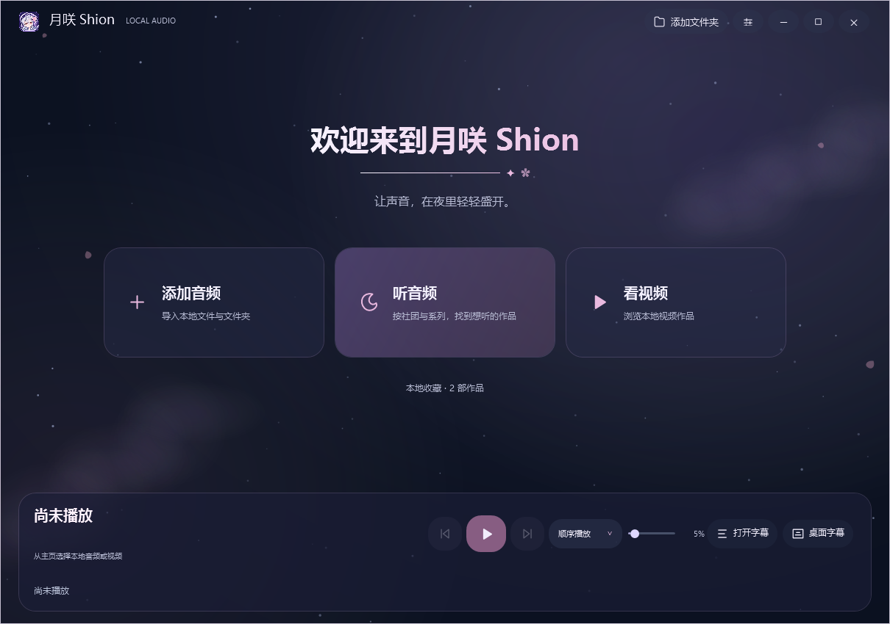
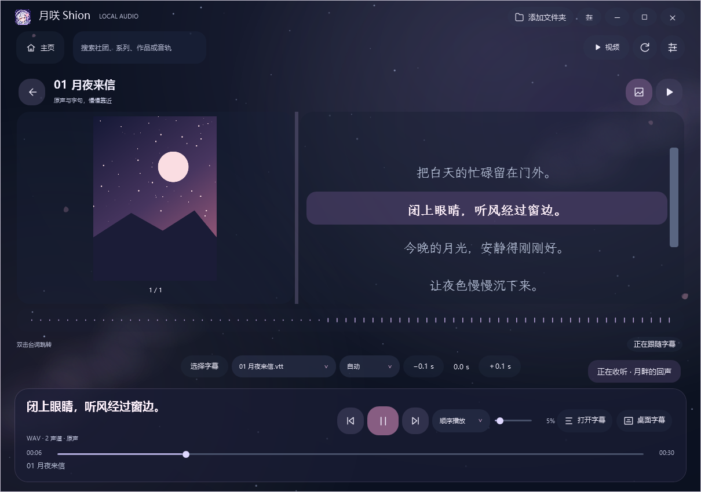
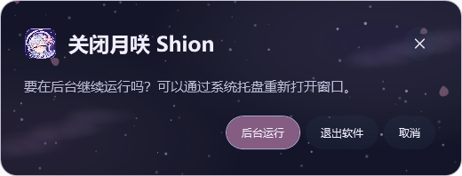

# 月咲 Shion

月咲 Shion 是一款用于 Windows 的本地 ASMR 播放器。可以整理按社团和系列收藏的音声，播放随附字幕的音频或视频，也可以把字幕浮在其他窗口上方。媒体、索引与进度保存在本机，播放无需账号。



*使用演示媒体库的欢迎主页。*



*音频播放页同时显示定时字幕和作品图片。*

## 下载和启动

在 [GitHub Releases](https://github.com/Shion39-Miku/Shion-ASMR/releases) 下载 Windows x64 便携包。完整解压 ZIP 后运行顶层的 `月咲 Shion.exe`，保留同级的 `runtime` 目录。可右键用 PowerShell 运行同级的 `create-shortcut.ps1`，在当前用户的开始菜单生成快捷方式。

系统要求为 Windows 10 22H2 或 Windows 11 x64。便携包内含 .NET 10 桌面运行时，启动器使用 Windows 自带的 .NET Framework 4.x。常规使用不需要单独安装 SDK。视频能否解码取决于 Windows 的媒体组件和文件内的编码。

首次启动可点「添加音频」选择本地文件或媒体文件夹，也可直接点右上的「添加文件夹」。扫描完成后点「听音频」或「看视频」。按社团、系列和作品浏览，也可搜索或用标签筛选。分类、封面与标签调整保存在播放器中。

完整的操作说明见 [使用教程](docs/usage.md)。

## 播放与字幕

| 类型 | 可用格式及条件 |
| --- | --- |
| 音频 | WAV、MP3、FLAC、M4A（AAC）、Ogg Vorbis。可解码范围取决于文件编码和 Windows 媒体组件。 |
| 视频 | 可选 MP4、M4V、MOV、WMV、AVI、MKV。已验证 H.264／AAC MP4，其他容器中的编码组合以本机解码能力为准。 |
| 字幕 | 外部 LRC、WebVTT（.vtt）。字幕页可手动选文件、切换编码和调时间偏移。 |
| 图片 | JPG、JPEG、PNG、WebP、BMP。可查看文件夹或作品里的图片，并指定封面。 |

- 同名字幕自动匹配，音轨记住上次听到的位置和字幕选项。点「打开字幕」进入完整字幕页，双击台词可跳转。音频在台词空档保留最近一句，视频按字幕时间范围显示。
- 播放栏的「桌面字幕」用于开关悬浮窗。编辑时拖黑底移动，拖边缘或四角调整尺寸。锁定后歌词保持透明，鼠标经过文字附近会出现小锁，可点它解锁。
- 点播放栏的模式菜单，可选择顺序播放、列表循环、单曲循环或「播完当前文件夹后暂停」。播放器提供音量调节和约 0.5 秒的暂停淡出／恢复淡入。
- 主窗口快捷键在前台生效。空格播放／暂停，← 后退 3 秒，→ 前进 5 秒，↑／↓ 调整音量 5 个百分点。文本输入时让位给编辑操作。
- 点击主窗关闭按钮或按 Alt+F4，选择「后台运行」「退出软件」或「取消」。后台运行时保留音频及已开启的桌面字幕，通过托盘双击或「打开月咲 Shion」恢复窗口。托盘「退出软件」会直接保存并退出。



*关闭确认提供后台运行、退出软件和取消。*

## 数据位置

设置、媒体索引和进度位于 `%LOCALAPPDATA%\Nocturne`。更名后的版本继续读取这个目录。若需要备份，可先完全退出播放器，再复制该目录。音视频、图片及字幕本身仍存放在原来的媒体文件夹。

## 从源码开发

在 Windows x64 安装 [.NET 10 SDK](https://dotnet.microsoft.com/download/dotnet/10.0)，用 Windows PowerShell 在仓库根目录运行下列命令。客户端使用 C#、WPF 与 NAudio，图像使用 SkiaSharp，项目依赖由 NuGet 锁定。

```powershell
dotnet restore src/Nocturne/Nocturne.csproj -r win-x64 --locked-mode --configfile NuGet.Config
dotnet run --project src/Nocturne/Nocturne.csproj -c Release -r win-x64 --no-restore
powershell -NoProfile -ExecutionPolicy Bypass -File scripts/build.ps1
```

打包脚本会在本地 `发行/` 生成 `Tsukisaki-Shion-1.13.0-win-x64.zip`。构建时会从项目中的品牌 PNG 生成多尺寸 ICO。依赖与字体授权见 [第三方说明](THIRD-PARTY-NOTICES.md)。

## 已知限制与反馈

视频解码受本机媒体组件影响。桌面字幕的透明和点击穿透以普通桌面窗口为验证范围，游戏独占全屏和物理混合 DPI 的兼容性仍需更多验证。遇到问题可在 [GitHub Issues](https://github.com/Shion39-Miku/Shion-ASMR/issues) 提交版本号、Windows 版本、复现步骤及可公开的示例。
