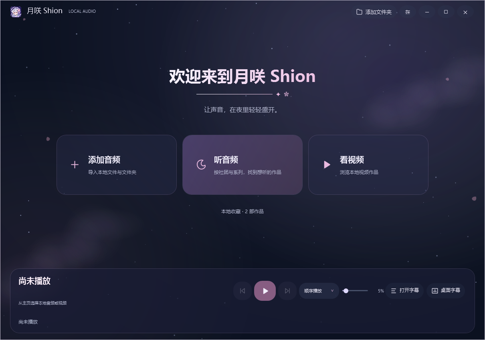
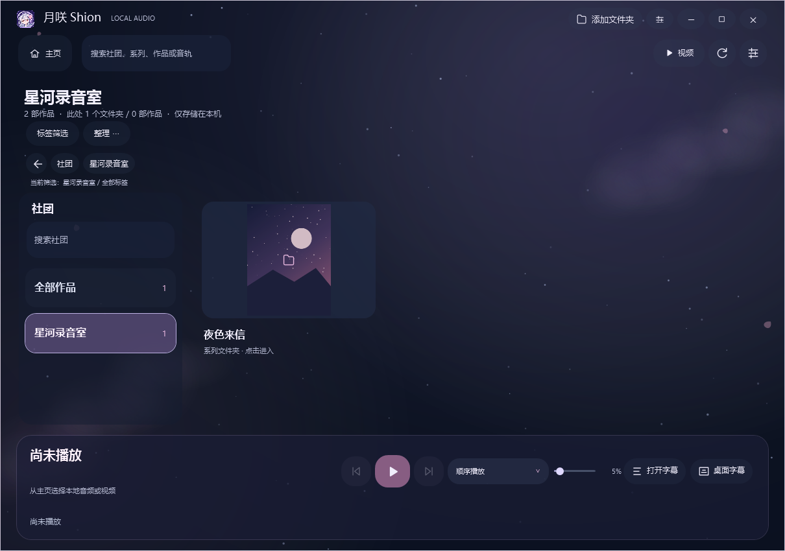
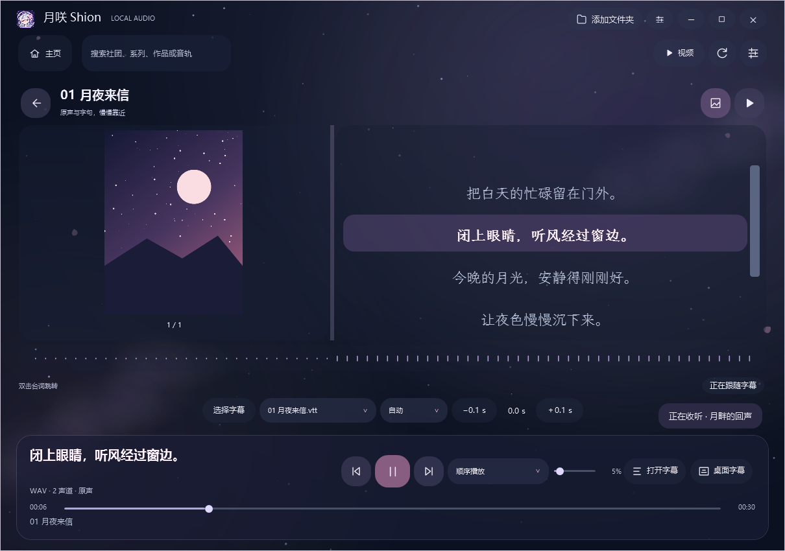
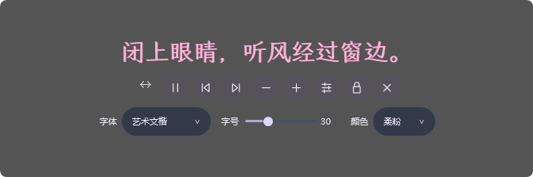
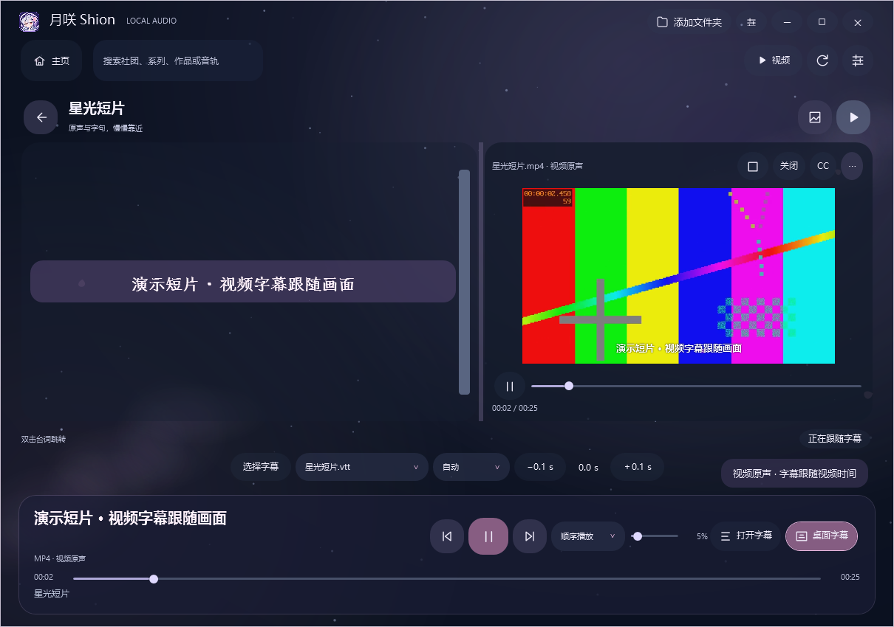
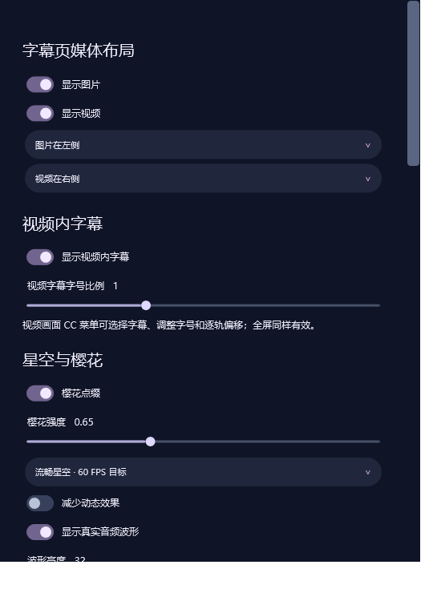

# 月咲 Shion 使用教程

## 1. 启动与添加媒体

从 [GitHub Releases](https://github.com/Shion39-Miku/Shion-ASMR/releases) 下载 x64 便携 ZIP，完整解压后运行 `月咲 Shion.exe`。保留旁边的 `runtime` 文件夹。首次使用无需配置账号或安装额外依赖。也可以按 [README 的源码开发步骤](../README.md#从源码开发) 构建。

在主页点「添加音频」，选择「选择本地音频文件」或「选择媒体文件夹」。选择音频文件时，播放器扫描所选文件的所在目录。也可用右上的「添加文件夹」直接选择目录，导入完成后界面会显示扫描结果。

重新启动后，播放器会先打开主页，再在后台核对上次添加的目录。移动硬盘暂时断开时，可接回硬盘并在媒体目录管理中刷新。主动选择「移除选中目录」会将该目录移出分类和续听候选。重新添加时仍可使用之前的收听记录。

## 2. 从导入到继续收听

例如，将 `月夜来信.wav`、`月夜来信.vtt` 和 `封面.png` 放在同一个作品文件夹里。添加该文件夹，扫描后点「听音频」，在「全部作品」或相应社团、系列中进入作品，选择这首音轨开始播放。字幕会自动加载，作品图片随当前作品显示。结束收听后再打开这首音轨，可从记住的位置继续播放；分类页也有「继续收听」入口。

左栏用于切换社团，进入系列后可通过面包屑返回，或点「返回上一级」进入父目录。从作品返回会恢复先前的搜索、标签和滚动位置。通过「整理」菜单可以打开「文件夹层级浏览」，也可以维护分类文件夹、社团和自定义标签。

某首音轨损坏或不受本机解码组件支持时，检查提示后选择同作品的其他音轨。若已有音轨在播放，仍可继续收听。

## 3. 字幕匹配、偏移与定位

优先把字幕放在音轨旁边，并把两者的文件名主体写成一致，例如 `月夜来信.wav` 和 `月夜来信.vtt`。支持 LRC 和 VTT。同名匹配失败时，在字幕页点「选择字幕」选取对应文件。乱码可尝试切换字幕编码，再检查文件内容。

字幕比声音早时点「＋0.1 s」延后，比声音晚时点「−0.1 s」提前。底栏「打开字幕」进入完整页面。双击台词可把播放位置跳到该句，滚动查看其他台词后可点「回到当前台词」。更换音轨会更新当前字幕。

## 4. 桌面字幕

点底栏「桌面字幕」打开悬浮窗并进入编辑状态。拖动黑底的空白处或台词可移动窗口，拖边缘或四角可缩放。用工具栏选择字体、字号和颜色，或点齿轮打开设置。放开鼠标后尺寸与位置会保存。

点锁图标进入透明穿透状态。将鼠标移到当前台词附近，点文字下方出现的小锁可恢复编辑。字幕为空时，可在托盘菜单选择桌面字幕的解锁入口，也可以通过播放栏关闭后重新开启。编辑工具栏的叉号与底栏开关都可以关闭桌面字幕。

## 5. 图片与视频

播放器在音轨所在文件夹和所属作品里查找图片，作品子目录也可参与查找。多张图片可用上一张、下一张按钮切换。图片没显示时，先检查字幕页的图片开关，再检查文件扩展名、能否读取，最后通过媒体目录管理刷新索引。

主页「看视频」可以浏览媒体库中的视频，也可以用顶栏「视频」直接选择视频文件。视频可匹配同名 LRC 或 VTT，播放器提供字幕显示和偏移控制。配套视频模式允许在听音频时显示视频，声音以主音轨为准。若某个视频无法打开，可换用已验证的 H.264／AAC MP4 编码组合。

## 6. 播放模式、按键和外观

在底栏模式菜单中选择「顺序播放」「列表循环」「单曲循环」或「播完当前文件夹后暂停」。窄窗口下可将鼠标停在模式菜单上，查看完整模式名称。调整滑块可定位或改变音量。设置中可以开启「暂停淡出／恢复淡入」，过渡约 0.5 秒。

| 快捷键 | 操作 |
| --- | --- |
| 空格 | 播放或暂停 |
| ← | 后退 3 秒 |
| → | 前进 5 秒 |
| ↑ / ↓ | 将音量增减 5 个百分点 |
| Alt+F4 | 在主窗打开关闭确认 |

播放快捷键作用于播放器前台窗口，输入框保留文本编辑操作。设置中还可调字幕字号、字重、行距，切换图片／视频显示和布局，以及调整星空、樱花、波形与「减少动态效果」。

## 7. 后台运行、恢复及退出

点主窗右上角的关闭按钮或按 Alt+F4。

- 「后台运行」隐藏窗口，保留当前音轨的播放或暂停状态和已开启的桌面字幕。
- 「退出软件」保存进度、设置和窗口位置，再结束播放器。
- 「取消」、Esc 或弹窗右上角的叉号返回主窗口。

在任务栏通知区双击月咲 Shion 图标，或右键选「打开月咲 Shion」，即可恢复当前窗口和浏览位置。托盘还提供「播放／暂停」与直接「退出软件」。如果托盘注册失败，播放器会显示原因并保持窗口可见。
